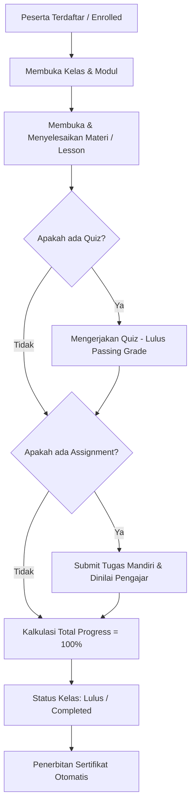

# [EPIC / PLAN] Pengembangan Sistem LMS E-Learning (Laravel + React + PostgreSQL)

## 📌 1. Ringkasan Proyek & Tujuan
Platform **Learning Management System (LMS) E-Learning** modern, modular, dan handal yang fokus pada pencatatan dan pelacakan proses pembelajaran (*learning progress*) secara riil, bukan sekadar tempat penyimpanan dokumen (*file repository*).

### 🛠️ Tech Stack
- **Backend**: Laravel (PHP 8.2+) — REST API & Inertia.js
- **Frontend**: React (Vite / Inertia React / Tailwind CSS / Lucide Icons)
- **Database**: PostgreSQL (`lms_db`)
- **Authentication & RBAC**: Laravel Breeze & Spatie Laravel-Permission
- **Storage**: Local / S3-compatible untuk materi PDF, video, & dokumen tugas

---

## 🧩 2. Komponen & Modul Utama Sistem

| Modul | Fungsi & Cakupan |
| :--- | :--- |
| **User Management & RBAC** | Autentikasi, registrasi, profil, manajemen peran (Admin, Pengajar/Instruktur, Siswa/Peserta). |
| **Course / Kelas** | Pembuatan kelas, silabus, kategori, status publikasi (Draft, Published, Archived). |
| **Materi (Lessons)** | Konten belajar multi-format: Video, Dokumen PDF, Dokumen Teks/Markdown, Link/Embed presentasi. |
| **Learning Path** | Penataan urutan modul/materi (sequential ordering) dan prasyarat sebelum membuka bab berikutnya. |
| **Quiz / Ujian** | Pembuat kuis (pilihan ganda, esai), timer pengerjaan, randomisasi soal, dan auto-grading. |
| **Assignment** | Pengumpulan tugas mandiri, batas waktu pengumpulan (deadline), dan sistem upload file. |
| **Progress Tracking** | Engine pelacakan progres belajar per materi, persentase penyelesaian, dan auto-unlock materi. |
| **Discussion / Forum** | Forum diskusi interaktif per materi/kelas antara siswa dan pengajar. |
| **Assessment & Grading** | Rekap nilai kuis, penilaian esai/tugas oleh pengajar, dan kartu hasil belajar. |
| **Certificate** | Generate sertifikat digital (PDF dengan kode verifikasi/QR) otomatis setelah peserta lulus kelas. |
| **Notification** | Pengingat tugas/ujian mendekati deadline, materi baru, dan pengumuman kelas (in-app & email). |
| **Reporting & Analytics** | Laporan analitik kelas, performa peserta, rata-rata kelulusan, dan export (Excel/PDF). |

---

## 🎯 3. Inti Sistem: Pelacakan Progres Belajar (Learning Progress Engine)

Sistem memastikan peserta menuntaskan alur belajar berurutan (*sequential learning*).

### Visualisasi Status Modul & Materi:
- ✅ **Selesai (Completed)**: Materi/tugas telah diselesaikan, dihitung ke dalam total progres.
- 🔵 **Sedang Berjalan (Active / In Progress)**: Materi yang sedang dipelajari saat ini.
- 🔒 **Terkunci (Locked)**: Materi berikutnya yang terkunci hingga materi sebelumnya ditandai selesai.

**Rumus Perhitungan Progres Kelas:**
$$\text{Progress (\%)} = \left( \frac{\text{Jumlah Item Selesai (Lesson + Quiz + Assignment)}}{\text{Total Item dalam Kelas}} \right) \times 100$$

---

## 🖥️ 4. Spesifikasi Dashboard Berdasarkan Peran

### A. Dashboard Peserta (Learner / Student)
- **Hero Banner / Quick Action**:
  - Salam pembuka: *"Welcome back, [Nama Siswa] 👋"*
  - **Continue Learning Card**: Menampilkan kelas terakhir diakses beserta progress bar (misal: 65%) dan tombol CTA `[ Lanjutkan Belajar → ]`.
- **My Courses Grid**: Tab *Sedang Berjalan (In Progress)* & *Selesai (Completed)*.
- **Upcoming Deadlines & Schedule**: Daftar tugas dan kuis yang mendekati batas waktu pengumpulan.
- **Recent Grades & Feedback**: Nilai kuis dan catatan evaluasi dari pengajar untuk tugas yang telah dikoreksi.
- **My Certificates**: Galeri sertifikat yang bisa diunduh langsung dalam format PDF.

---

### B. Dashboard Pengajar (Instructor)
- **Ringkasan Kelas Saya (Course Analytics Summary)**:
  - Jumlah kelas aktif yang diampu, total peserta terdaftar, rata-rata progres kelas (misal: 68%), rata-rata nilai kuis (misal: 82).
- **Status Aktivitas Peserta**: Peserta aktif vs belum memulai belajar sama sekali.
- **Pending Tasks / Needs Grading**: Daftar pengumpulan tugas peserta yang butuh dinilai/koreksi (contoh: *"12 tugas belum diperiksa"*).
- **Course Management Shortcut**: Buat kelas baru dan kelola materi.

---

### C. Dashboard Administrator
- **High-Level Metrics Widgets**: Total Users, Total Active Courses vs Completed Courses, Active Learners, Pending Submissions.
- **Manajemen Master Data**: User & Role Management, Kategori Kelas, Template Sertifikat, Konfigurasi Sistem, Export Laporan & Audit Logs.

---

## 🗄️ 5. Database Schema (PostgreSQL)

1. `users` (id, name, email, password, avatar, phone, bio, status, timestamps)
2. `roles` & `permissions` (via Spatie Laravel-Permission)
3. `course_categories` (id, name, slug, icon, description, timestamps)
4. `courses` (id, instructor_id, category_id, title, slug, thumbnail, description, level, status, timestamps)
5. `course_modules` (id, course_id, title, description, sort_order, timestamps)
6. `lessons` (id, module_id, title, slug, content_type [video, pdf, text, embed], content_body/url, duration_minutes, is_preview, sort_order, timestamps)
7. `enrollments` (id, user_id, course_id, enrolled_at, status [active, completed, dropped], progress_percentage, completed_at, timestamps)
8. `lesson_progress` (id, user_id, lesson_id, status [completed], completed_at, timestamps)
9. `quizzes` (id, course_id, module_id, title, description, passing_score, time_limit_minutes, sort_order, timestamps)
10. `quiz_questions` (id, quiz_id, question_text, question_type, points, options [jsonb], answer_key, sort_order, timestamps)
11. `quiz_attempts` (id, user_id, quiz_id, score, is_passed, answers [jsonb], started_at, finished_at, timestamps)
12. `assignments` (id, course_id, module_id, title, instructions, due_date, max_score, file_attachment_url, sort_order, timestamps)
13. `assignment_submissions` (id, assignment_id, user_id, submission_file_url, notes, grade, feedback, graded_by, submitted_at, graded_at, timestamps)
14. `assessments` (id, enrollment_id, final_grade, letter_grade, notes, evaluated_at, timestamps)
15. `certificates` (id, user_id, course_id, certificate_number, file_url, issued_at, timestamps)
16. `discussions` (id, course_id, lesson_id, user_id, parent_id, comment, timestamps)

---

## 📋 6. Status Implementasi

- [x] Inisialisasi Proyek Laravel + React (Inertia.js) + Tailwind CSS + Lucide Icons
- [x] Konfigurasi Database PostgreSQL (`lms_db`)
- [x] Role & Permission dengan Spatie (`admin`, `instructor`, `student`)
- [x] Database Migration untuk seluruh 16 tabel LMS
- [x] Model Eloquent & Relasi Lengkap
- [x] Core Services: `ProgressTrackingService` & `CertificateService`
- [x] Seeding data demo: Kelas "Dasar-Dasar Pengantar Kerja" lengkap dengan modul, materi, kuis, tugas, serta akun demo Admin, Pengajar, dan Siswa
- [x] Controller & Endpoint: Dashboard, Catalog, Classroom, Quiz, Assignment, Certificate, Discussion
- [x] Tampilan Frontend React (Student Dashboard, Instructor Dashboard, Admin Dashboard, Classroom Learning with Sequential Locking, Quiz, Assignment Submission, Digital Certificate)
- [x] Unit & Feature Testing (26 passed tests, 74 assertions)
